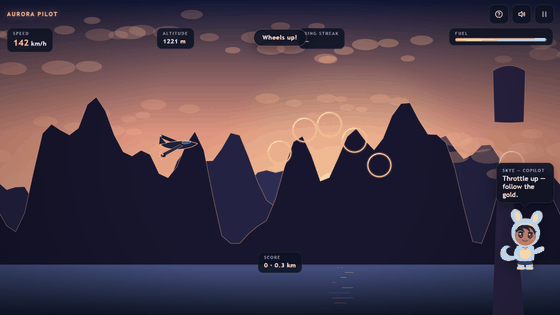

# AURORA PILOT

**Fly the dawn mail run through the canyon.** Thread golden rings, keep the tanks fed, and ride the sunrise through four skies in one smooth, floaty tiltwing.

[▶ Play Aurora Pilot](https://siddhant-pardeshi.github.io/aurora-pilot/) — free, no install, no login. Phones and desktops.



## The pitch

First light over the canyon, and the mail has to move. You fly the dawn route in a tiltwing with real inertia — climb and she bleeds speed, dive and she comes back alive. Golden rings pay the bills (chain them without a miss and the streak multiplies), stone spires tax your hull, and parachute canisters drop fuel when the tank runs thin. Every sixty seconds the sky changes: dawn, bright day, dusk, then the starry night run home.

It is a game about smoothness. No shooting, no timers — just you, the light, and the next ring.

## Flight briefings: learn how the internet moves

Each sky you cross is a **layer of the network**. When the light shifts, Skye hands you a flight briefing — a quick concept card about the layer you just flew (DNS, TCP, TLS, CDN, why 503 means what it means). A correct briefing is worth +250, refills +25 fuel, and **insures your ring streak** (the next missed ring won't reset it). A missed briefing drains -20 fuel — and fuel is life up here. Every concept is tracked in the menu's **Concepts** codex. Briefings pause the flight; skip is always one tap away.

## Controls

| Action | Keyboard | Touch |
| --- | --- | --- |
| Pitch up / down | `↑` `↓` / `W` `S` | Joystick (vertical) |
| Boost surge | `Shift` | BOOST button |
| Pause | `Esc` / `P` | Pause icon |

- **Rings** chain into a streak multiplier — missing one resets it.
- **Spires and arches** cost hull on contact; three hits end the run.
- **Fuel** drains constantly (~90 seconds a tank). Empty tank = engine out, glide down.
- Full guide: [docs/HOW_TO_PLAY.md](docs/HOW_TO_PLAY.md).

## Skye, your copilot

The character in the corner is Skye — warm voice on the intercom. She greets you, calls ring streaks and low fuel with real animations, winces at rock strikes, narrates the sky shifts, and sleeps when you pause. Hide or mute her in Settings. Rig details: [docs/mascot-guide.md](docs/mascot-guide.md).

## Accessibility & settings

Volume sliders and mute (`M`), quality tiers, reduced motion, camera-shake toggle, hideable mascot, fullscreen, keyboard-playable menus, touch targets ≥ 44px. Fully playable muted.

## Privacy

No accounts, no cookies, no analytics, no tracking — nothing leaves your device. Progress and settings live in your browser's localStorage and can be wiped anytime from Settings. Full details: [SECURITY.md](SECURITY.md) and the deck-wide [privacy statement](https://github.com/siddhant-pardeshi/game-deck/blob/main/PRIVACY.md).

## Under the hood

One shared game kit, zero downloaded assets: four full sky palettes crossfade over parallax canyon layers, the plane is drawn vector geometry with bank animation, and the soundtrack — airy pads, warm arps, wind — is synthesized live with WebAudio. Personal best lives in localStorage.

- [docs/HOW_TO_PLAY.md](docs/HOW_TO_PLAY.md)
- [docs/mascot-guide.md](docs/mascot-guide.md)
- [docs/QA.md](docs/QA.md)

## Run it locally

```bash
python -m http.server 8000
# open http://localhost:8000
```

## About

**Made by Siddhant Pardeshi.** Part of [The Game Deck](https://siddhant-pardeshi.github.io/game-deck/) — six handcrafted worlds on one shared game kit, each with its own curriculum woven into the mechanics.

## License

MIT — see [LICENSE](LICENSE). All code, art, characters and music are original work.

Inspired by classic mail-run aviation. Not affiliated with or endorsed by any studio or publisher.
